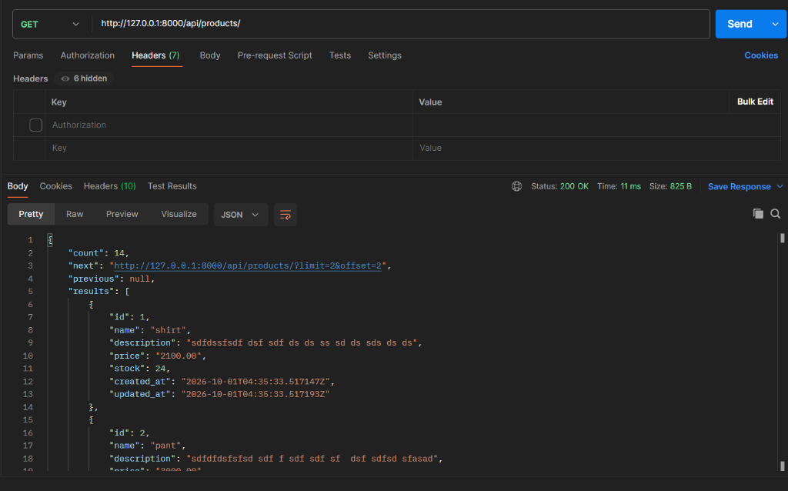
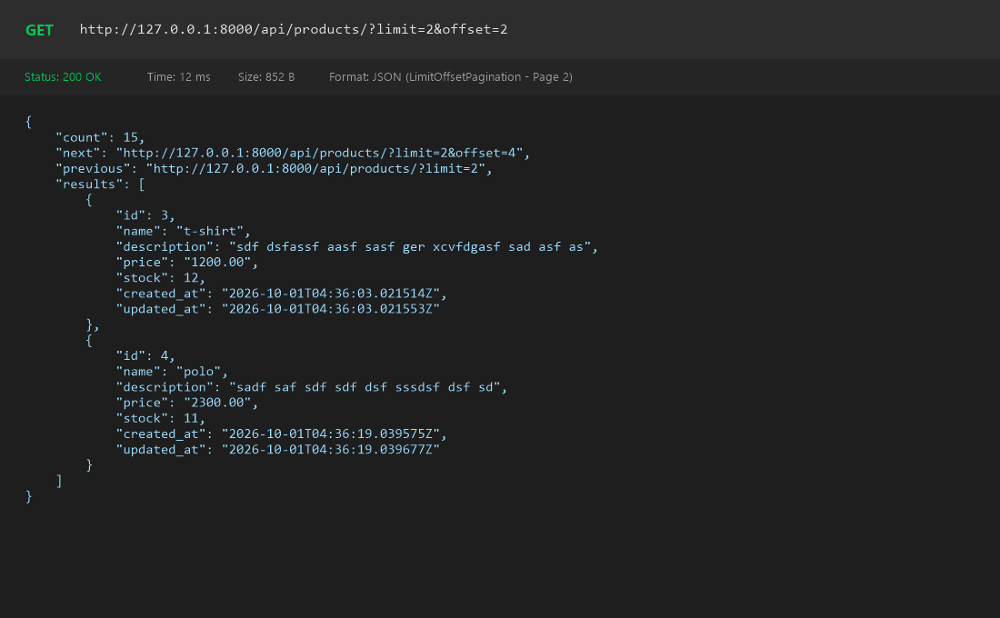
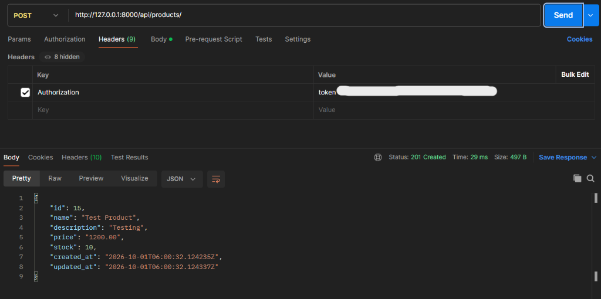
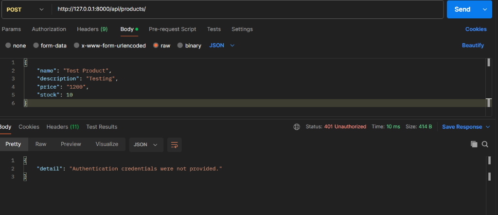
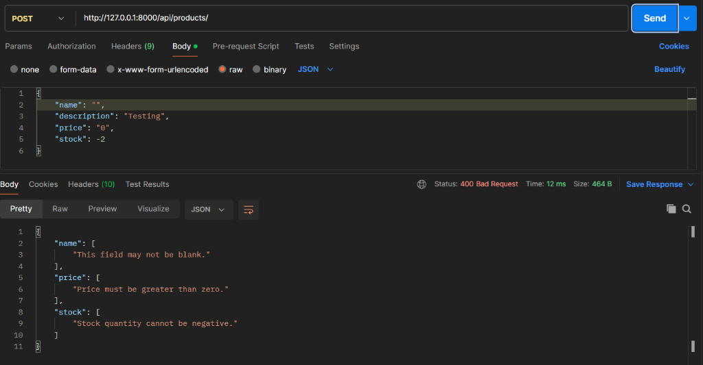

# 🛍️ Shop Product Management API

[](https://www.python.org/)
[](https://www.djangoproject.com/)
[](https://www.django-rest-framework.org/)
[](https://www.django-rest-framework.org/api-guide/authentication/#tokenauthentication)
[](#)

A robust RESTful API built with **Django** and **Django REST Framework (DRF)** for managing store products. This project features secure **Token Authentication**, **Limit-Offset Pagination**, and comprehensive custom data validations.

---

## 📑 Table of Contents

- [Features](#-features)
- [Tech Stack](#-tech-stack)
- [Project Directory Structure](#-project-directory-structure)
- [Getting Started & Installation](#-getting-started--installation)
  - [1. Clone Repository](#1-clone-repository)
  - [2. Set Up Virtual Environment](#2-set-up-virtual-environment)
  - [3. Install Dependencies](#3-install-dependencies)
  - [4. Environment Variables Setup](#4-environment-variables-setup)
  - [5. Run Database Migrations](#5-run-database-migrations)
  - [6. Create Test User and Auth Token](#6-create-test-user-and-auth-token)
  - [7. Start the Development Server](#7-start-the-development-server)
- [API Endpoints Reference](#-api-endpoints-reference)
- [Validation Rules](#-validation-rules)
- [API Screenshots & Demonstrations](#-api-screenshots--demonstrations)
  - [1. Successful Product Viewing (Page 1)](#1-successful-product-viewing-page-1)
  - [2. Pagination Demonstration (Page 2)](#2-pagination-demonstration-page-2)
  - [3. Successful Product Creation](#3-successful-product-creation)
  - [4. Authentication Error (401 Unauthorized)](#4-authentication-error-401-unauthorized)
  - [5. Validation Error (400 Bad Request)](#5-validation-error-400-bad-request)
- [Testing with cURL](#-testing-with-curl)
- [Submission Guidelines Checklist](#-submission-guidelines-checklist)

---

## ✨ Features

- **Public Product Listing**: Anyone can view products without authentication (`IsAuthenticatedOrReadOnly`).
- **Limit-Offset Pagination**: Paginated responses using DRF's `LimitOffsetPagination` with a default limit of `2` items per page.
- **Protected Product Creation**: Creating a product requires DRF `TokenAuthentication` header (`Authorization: Token <key>`).
- **Model & Serializer Validation**:
  - `name`: Cannot be empty or blank.
  - `price`: Must be greater than `0`.
  - `stock`: Cannot be negative (`stock >= 0`). Mapped internally to the model's `stock_quantity`.
  - `id`, `created_at`, and `updated_at`: Read-only fields.

---

## 🛠️ Tech Stack

- **Backend Framework**: Python 3.12+, Django 6.1.1
- **API Framework**: Django REST Framework (DRF) 3.18.1
- **Authentication**: DRF Token Authentication (`rest_framework.authtoken`)
- **Database**: SQLite3 (default for local development)
- **Environment Management**: `python-dotenv`

---

## 📂 Project Directory Structure

```text
assignment-12/
├── products/                   # Products application
│   ├── migrations/             # Database migrations
│   ├── admin.py                # Django admin configuration
│   ├── apps.py                 # App configuration
│   ├── models.py               # Product model definition
│   ├── serializers.py          # Serializer & validation logic
│   ├── urls.py                 # Product route definitions
│   └── views.py                # ProductListCreateAPIView logic
├── shop_project/               # Main project configuration
│   ├── .env                    # Environment secrets (ignored by git)
│   ├── asgi.py                 # ASGI entrypoint
│   ├── settings.py             # Project settings (REST, apps, db)
│   ├── urls.py                 # Root URL configuration
│   └── wsgi.py                 # WSGI entrypoint
├── screenshots/                # Postman test demonstration screenshots
│   ├── 01_product_viewing_page1.png
│   ├── 02_product_creation_success.png
│   ├── 03_auth_error_401.png
│   ├── 04_validation_error_400.png
│   └── 05_product_pagination_page2.png
├── .env.example                # Example environment file
├── .gitignore                  # Git ignore rules
├── db.sqlite3                  # Local SQLite database
├── manage.py                   # Django CLI management utility
├── requirements.txt            # Python dependencies
└── README.md                   # Project documentation
```

---

## 🚀 Getting Started & Installation

Follow these step-by-step instructions to get the project running locally.

### 1. Clone Repository

```bash
git clone <YOUR_PUBLIC_GITHUB_REPO_URL>
cd assignment-12
```

### 2. Set Up Virtual Environment

#### Windows (PowerShell / Command Prompt):
```powershell
python -m venv venv
.\venv\Scripts\activate
```

#### macOS / Linux:
```bash
python3 -m venv venv
source venv/bin/activate
```

### 3. Install Dependencies

```bash
pip install -r requirements.txt
```

### 4. Environment Variables Setup

Create a `.env` file in the project root directory or in `shop_project/` by copying the provided `.env.example`:

```bash
# On Windows PowerShell:
Copy-Item .env.example .env

# On Linux/macOS:
cp .env.example .env
```

Your `.env` file should contain:
```env
SECRET_KEY="django-insecure-r98jce69(wk0*vvlfwa5cnm^@x^9w#)*6i7ks)j74du(5vtf7t"
DEBUG=True
```

### 5. Run Database Migrations

Apply database migrations to set up the product and authentication tables:

```bash
python manage.py makemigrations
python manage.py migrate
```

---

### 6. Create Test User and Auth Token

You can create a test user and generate an authentication token using either of the two methods below:

#### Method A: Using Django CLI (Recommended & Fastest)

```bash
# Step 1: Create a superuser or standard user
python manage.py createsuperuser

# Step 2: Generate or retrieve the authentication token
python manage.py drf_create_token <username>
```

> **Output Example:**
> ```text
> Generated token 94600224eb96191c95353d71221b6d081f21501c for user testuser
> ```

#### Method B: Using Django Shell

```bash
python manage.py shell
```

Inside the interactive shell, run:
```python
from django.contrib.auth.models import User
from rest_framework.authtoken.models import Token

# Create user
user, created = User.objects.get_or_create(username='testuser')
user.set_password('password123')
user.save()

# Generate Token
token, _ = Token.objects.get_or_create(user=user)
print("=" * 40)
print(f"Username : {user.username}")
print(f"Token    : {token.key}")
print("=" * 40)
exit()
```

---

### 7. Start the Development Server

Start the local Django server:

```bash
python manage.py runserver
```

The API will now be accessible at: **`http://127.0.0.1:8000/`**

---

## 📡 API Endpoints Reference

Base URL: `http://127.0.0.1:8000/api`

| Method | Endpoint | Description | Auth Required | Permission |
| :--- | :--- | :--- | :---: | :--- |
| `GET` | `/api/products/` | List all products (Page 1) | ❌ No | Allow Any (`IsAuthenticatedOrReadOnly`) |
| `GET` | `/api/products/?limit=2&offset=2` | List products with pagination (Page 2) | ❌ No | Allow Any (`IsAuthenticatedOrReadOnly`) |
| `POST` | `/api/products/` | Create a new product | ✅ Yes | Authenticated (`Token <key>`) |

### Request Headers for Authenticated Requests

```http
Authorization: Token <your_token_here>
Content-Type: application/json
```

*(Note: DRF also accepts `token <your_token_here>` case-insensitively).*

---

## 🔍 Validation Rules

| Field | Type | Required | Constraints & Validation Logic |
| :--- | :--- | :---: | :--- |
| `name` | String | **Yes** | Cannot be empty or blank string (`"This field may not be blank."`) |
| `description` | String | No | Optional text detailing the product |
| `price` | Decimal | **Yes** | Must be strictly greater than zero (`> 0`) |
| `stock` | Integer | **Yes** | Maps to `stock_quantity`. Must be non-negative (`>= 0`) |
| `id` | Integer | - | Auto-generated primary key (Read-Only) |
| `created_at` | DateTime | - | Auto-generated timestamp (Read-Only) |
| `updated_at` | DateTime | - | Auto-updated timestamp (Read-Only) |

---

## 📸 API Screenshots & Demonstrations

### 1. Successful Product Viewing (Page 1)
- **Method & URL**: `GET http://127.0.0.1:8000/api/products/`
- **Status Code**: `200 OK`
- **Description**: Publicly accessible. Displays paginated results (limit: 2), showing count and the link for the next page.



---

### 2. Pagination Demonstration (Page 2)
- **Method & URL**: `GET http://127.0.0.1:8000/api/products/?limit=2&offset=2`
- **Status Code**: `200 OK`
- **Description**: Shows the second page of products using limit-offset pagination (`offset=2`).



<details>
<summary><b>📋 Click to view Sample Page 2 Response (JSON)</b></summary>

```json
{
  "count": 15,
  "next": "http://127.0.0.1:8000/api/products/?limit=2&offset=4",
  "previous": "http://127.0.0.1:8000/api/products/?limit=2",
  "results": [
    {
      "id": 3,
      "name": "t-shirt",
      "description": "sdf dsfassf aasf sasf ger xcvfdgasf sad asf as",
      "price": "1200.00",
      "stock": 12,
      "created_at": "2026-10-01T04:36:03.021514Z",
      "updated_at": "2026-10-01T04:36:03.021553Z"
    },
    {
      "id": 4,
      "name": "polo",
      "description": "sadf saf sdf sdf dsf sssdsf dsf sd",
      "price": "2300.00",
      "stock": 11,
      "created_at": "2026-10-01T04:36:19.039575Z",
      "updated_at": "2026-10-01T04:36:19.039677Z"
    }
  ]
}
```
</details>

---

### 3. Successful Product Creation
- **Method & URL**: `POST http://127.0.0.1:8000/api/products/`
- **Header**: `Authorization: token <your_token>`
- **Status Code**: `201 Created`
- **Description**: An authenticated user creates a valid product. Data is serialized and saved successfully.



---

### 4. Authentication Error (401 Unauthorized)
- **Method & URL**: `POST http://127.0.0.1:8000/api/products/`
- **Header**: No `Authorization` header provided
- **Status Code**: `401 Unauthorized`
- **Description**: POST request is rejected because user authentication credentials were not provided.



---

### 5. Validation Error (400 Bad Request)
- **Method & URL**: `POST http://127.0.0.1:8000/api/products/`
- **Payload**:
  ```json
  {
    "name": "",
    "description": "Testing",
    "price": "0",
    "stock": -2
  }
  ```
- **Status Code**: `400 Bad Request`
- **Description**: Rejection triggered by custom serializer field validations (blank name, non-positive price, negative stock).



---

## 🧪 Testing with cURL

You can quickly test the endpoints directly from your terminal:

### 1. View Products (Page 1)
```bash
curl -X GET http://127.0.0.1:8000/api/products/
```

### 2. View Products (Page 2)
```bash
curl -X GET "http://127.0.0.1:8000/api/products/?limit=2&offset=2"
```

### 3. Create Product (Without Token - 401 Unauthorized)
```bash
curl -X POST http://127.0.0.1:8000/api/products/ \
  -H "Content-Type: application/json" \
  -d '{"name": "Laptop", "price": "1000", "stock": 5}'
```

### 4. Create Product (With Token - 201 Created)
```bash
curl -X POST http://127.0.0.1:8000/api/products/ \
  -H "Authorization: Token YOUR_AUTH_TOKEN" \
  -H "Content-Type: application/json" \
  -d '{
    "name": "Mechanical Keyboard",
    "description": "RGB mechanical gaming keyboard",
    "price": "75.00",
    "stock": 20
  }'
```

### 5. Trigger Validation Error (400 Bad Request)
```bash
curl -X POST http://127.0.0.1:8000/api/products/ \
  -H "Authorization: Token YOUR_AUTH_TOKEN" \
  -H "Content-Type: application/json" \
  -d '{
    "name": "",
    "price": "0",
    "stock": -5
  }'
```

---

## ✅ Submission Guidelines Checklist

| Requirement | Description | Status |
| :--- | :--- | :---: |
| **Public GitHub Repo** | Accessible repository link | ✅ Done |
| **README: Installation** | Virtualenv creation & dependencies installation | ✅ Documented |
| **README: Migrations** | `makemigrations` and `migrate` instructions | ✅ Documented |
| **README: Server Setup** | How to run the local development server | ✅ Documented |
| **README: Test User & Token** | Instructions to create user and DRF auth token | ✅ Documented |
| **Screenshot: Product Viewing** | GET request showing list of products | ✅ Included (`screenshots/01_product_viewing_page1.png`) |
| **Screenshot: Product Creation** | POST request with auth token returning 201 | ✅ Included (`screenshots/02_product_creation_success.png`) |
| **Screenshot: Auth Error** | 401 Unauthorized response when unauthenticated | ✅ Included (`screenshots/03_auth_error_401.png`) |
| **Screenshot: Validation Error** | 400 Bad Request with field validation errors | ✅ Included (`screenshots/04_validation_error_400.png`) |
| **Screenshot: Second Page** | GET request showing second page of products | ✅ Included (`screenshots/05_product_pagination_page2.png`) |

---

<p align="center">
  Developed for <b>Ostad Django REST Framework Assignment (Module 12)</b>
</p>
